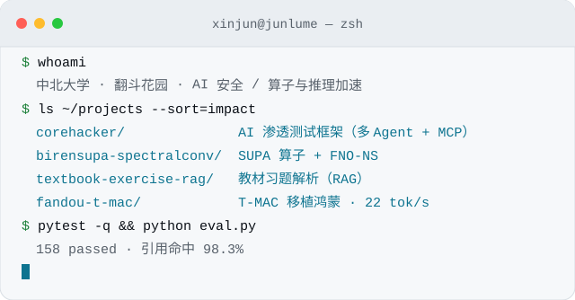
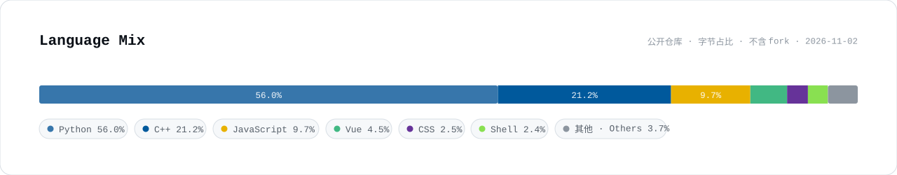

  <picture>
    <source media="(prefers-color-scheme: dark)" srcset="./assets/banner-dark.svg" />
    
  </picture>

  <i>⭐ 先立评测，再谈完成 —— 没有可复现的数字，就不算做完</i> 
  <i>🛡️ 让 Agent 去干脏活，让证据来决定结论</i>

<table width="100%">
  <tr>
    <td width="62%" valign="top">
      
你好，我是 <b>xinjun</b>（GitHub 上的 <code>junlume</code>），中北大学在读，<b>「翻斗花园」</b>小队成员。

      
主线是 <b>AI 安全</b>：把大模型接进真实的安全工具链，做渗透测试、钓鱼链接识别、漏洞挖掘。副线是 <b>算子与推理加速</b>：在国产卡和手机端把模型先跑对、再跑快。两条线用的其实是同一套方法——「先量准，再优化」。

      
<b>最近在做</b>

      <ul>
        <li>🛡️ <a href="https://github.com/junlume/corehacker"><b>corehacker</b></a> —— AI 渗透测试框架：多 Agent 分工 + MCP 工具扩展，按任务复杂度路由模型</li>
        <li>📱 <a href="https://github.com/junlume/fandou-t-mac"><b>fandou-t-mac</b></a> —— 把 T-MAC 的低比特查表推理移植到鸿蒙，零售 arm64 手机跑到 <b>22.00 tok/s</b></li>
        <li>🎣 <a href="https://github.com/junlume/phish"><b>phish</b></a> —— 把 ACL 2026《MemoPhishAgent》的实现读懂、跑通，并写成五维评审</li>
        <li>📚 <a href="https://github.com/junlume/pentest-ai-knowledge"><b>pentest-ai-knowledge</b></a> —— 12 个渗透测试 AI 项目的核心算法与架构拆解</li>
      </ul>
      
写东西的习惯：结论必须能点回原文，性能必须能重跑复现。做不到，就先别说完 🫡

    </td>
    <td width="38%" align="center" valign="top">
       
      

        <b>NOW</b> 
        📍 中北大学 
        🎓 翻斗花园小队 
        🛡️ 主线　AI 安全 / LLM Agent 
        ⚡ 副线　算子 / 推理加速 
        🧪 信条　测试与评测先行
      

      

        <picture><source media="(prefers-color-scheme: dark)" srcset="./assets/status-building-dark.svg" /></picture> 
        <picture><source media="(prefers-color-scheme: dark)" srcset="./assets/status-shipped-dark.svg" /></picture> 
        <picture><source media="(prefers-color-scheme: dark)" srcset="./assets/status-learning-dark.svg" /></picture>
      

    </td>
  </tr>
</table>

  <picture>
    <source media="(prefers-color-scheme: dark)" srcset="./assets/terminal-dark.svg" />
    
  </picture>

---

## Selected work

<table width="100%">
  <tr>
    <td width="50%" valign="top">
      <h3>🛡️ <a href="https://github.com/junlume/corehacker">CoreHacker</a></h3>
      
把多 Agent 协作和职业安全工具接在一起，做自动化漏洞评估。<b>重复劳动交给 Agent，判定仍然靠证据。</b>

      
<code>Nmap</code> <code>SQLMap</code> <code>Nikto</code> <code>WPScan</code> <code>Burp</code> 已接成 MCP 工具；异步执行 + Rich 实时状态；按任务复杂度自动路由模型（轻任务小模型，硬任务大模型）。当前 <b>v0.4.0</b>。

    </td>
    <td width="50%" valign="top">
      <h3>🧮 <a href="https://github.com/junlume/birensupa-spectralconv">Biren SUPA SpectralConv</a></h3>
      
在壁仞 106B 上用 SUPA + PyTorch 扩展实现 FNO 的核心 2D Spectral Convolution，拼四层 Fourier 层做二维不可压 Navier–Stokes 涡量预测。

      
公开集 NS64 相对 L2 <b>0.035012</b>；算子延迟 <b>0.599 / 1.405 / 5.099 ms</b>（64 / 128 / 256）；正确性 worst rel <b>7.16×10⁻⁶</b>（判定阈值 1e-4）。

    </td>
  </tr>
  <tr>
    <td width="50%" valign="top">
      <h3>🎯 <a href="https://github.com/junlume/textbook-exercise-rag">Textbook Exercise RAG</a></h3>
      
上传教材与习题册，出解析，<b>每条结论都能点回原文</b>。稠密召回 + BM25 → RRF 融合 → 轻量重排，相似度门控决定「有依据才答、没依据就拒答」。

      
60 题评测引用命中 <b>98.3%</b>；27 组离线检索消融；后端 <b>158</b> 项 pytest 全绿；云 / Ollama / mock 三条模型通道热切换。

    </td>
    <td width="50%" valign="top">
      <h3>📱 <a href="https://github.com/junlume/fandou-t-mac">T-MAC on HarmonyOS</a></h3>
      
把 T-MAC 的低比特查表推理移植到鸿蒙手机：BitNet-b1.58-3B 以 <b>2.44 bpw</b> 在零售 arm64 机型上跑到 <b>22.00 tok/s</b>（桌面 Q4_0 对照 15.94）。

      
chained-KV 让 TTFT 从 <b>240 ms</b> 降到 <b>1.32 ms</b>；配套后台感知调度。完整报告见 <code>ohos/FULL-REPORT.md</code>。

    </td>
  </tr>
</table>

📦 还有一些在读、在整理的仓库（点开看）

 

- 🎣 **[phish](https://github.com/junlume/phish)** —— ACL 2026 Industry Track《MemoPhishAgent》的本地复现与五维评审（架构 / 提示词 / 代码 / 安全 / 工程），覆盖四种模式消融，含 753 条自建 SocPhish 数据集。
- 📚 **[pentest-ai-knowledge](https://github.com/junlume/pentest-ai-knowledge)** —— AI-Infra-Guard、HexStrike AI、PentAGI、PentestGPT、CyberStrikeAI 等 12 个项目的核心创新点与学习优先级。
- 🧩 **[clause-rag-workbench](https://github.com/junlume/clause-rag-workbench)** —— 保险条款问答台：引用追溯 + 无依据拒答闸门，和上面那套 RAG 工程是同一个思路的另一个落点。
- 🤖 **[robocup-drone-sim](https://github.com/junlume/robocup-drone-sim)** · **[cool-ui-gallery](https://github.com/junlume/cool-ui-gallery)** —— RoboCup 无人机仿真（ROS / Gazebo）与前端 UI 合集（Vue 3 / Astro + WebGL）。

---

## Tech stack

| | |
|---|---|
| **语言** | `Python` `TypeScript / JavaScript` `C++` `PowerShell` `Go`（阅读） |
| **AI 安全** | `Multi-Agent` `MCP` `LangGraph / ReAct` `渗透工具链` `钓鱼 URL 检测` `证据链与复现` |
| **检索 / LLM** | `RAG` `BM25 + RRF` `ChromaDB` `fastembed` `OpenAI 兼容 / Ollama` |
| **算子 / 推理** | `PyTorch` `Biren SUPA` `ONNX` `延迟与正确性基准` |
| **工程** | `FastAPI` `Vue 3` `Vite` `SQLite` `Pydantic` `pytest` `Docker` `GitHub Actions` |

  <picture>
    <source media="(prefers-color-scheme: dark)" srcset="./assets/langcard-dark.svg" />
    
  </picture>

---

## 正在做 / 正在学

<table width="100%">
  <tr>
    <td width="50%" valign="top">
      <h4>🛡️ 安全 Agent 的证据链</h4>
      
Agent 能把采集和尝试自动化，但「这个漏洞是真的」不能靠模型自己说。下一步给 CoreHacker 补上：结论必须挂证据、失败要能回滚重试、每一步留可追溯日志。

      
<code>Agent</code> <code>Evidence</code> <code>Verification</code>

    </td>
    <td width="50%" valign="top">
      <h4>🎣 钓鱼 / 恶意链接的多模态检测</h4>
      
沿着 MemoPhishAgent 那条线继续：截图与页面文本怎么进决策链、情景记忆怎么复用相似样本，把四种模式的对照实验复现成自己的消融。

      
<code>Multimodal</code> <code>Memory</code> <code>Ablation</code>

    </td>
  </tr>
  <tr>
    <td width="50%" valign="top">
      <h4>⚡ 推理加速与算子</h4>
      
从「能让算子跑对」走向「能让它跑快」：访存与算子融合、并行切分、批大小的影响，顺手把国产卡上的性能度量做规范。

      
<code>SUPA</code> <code>Operator</code> <code>Latency</code>

    </td>
    <td width="50%" valign="top">
      <h4>🔍 检索工程</h4>
      
切块粒度、重排权重 α、门控阈值的联动，用消融结果说话而不是凭感觉调参。底子不能丢。

      
<code>RAG</code> <code>RRF</code> <code>Rerank</code>

    </td>
  </tr>
</table>

---

## 联系

安全 Agent、RAG 检索、算子加速这几个方向想交流，或者想复现某个仓库，直接在对应仓库开 **Issue** 就行，我会回 🙌
想要哪个项目的详细说明或复现步骤，也可以开 Issue 点单。

  <a href="https://github.com/junlume" title="GitHub · junlume">
    <picture>
      <source media="(prefers-color-scheme: dark)" srcset="https://cdn.simpleicons.org/github/ffffff" />
      
    </picture>
  </a>
  &nbsp;&nbsp;&nbsp;
  <a href="https://github.com/junlume/corehacker" title="CoreHacker">
    <picture>
      <source media="(prefers-color-scheme: dark)" srcset="https://cdn.simpleicons.org/shieldsdotio/ffffff" />
      
    </picture>
  </a>
  &nbsp;&nbsp;&nbsp;
  <a href="https://github.com/junlume/pentest-ai-knowledge" title="渗透测试 AI 知识库">
    <picture>
      <source media="(prefers-color-scheme: dark)" srcset="https://cdn.simpleicons.org/readthedocs/ffffff" />
      
    </picture>
  </a>
  &nbsp;&nbsp;&nbsp;
  <a href="https://github.com/junlume/textbook-exercise-rag" title="Textbook Exercise RAG">
    <picture>
      <source media="(prefers-color-scheme: dark)" srcset="https://cdn.simpleicons.org/fastapi/ffffff" />
      
    </picture>
  </a>

<i>素材由 <code>scripts/make_assets.py</code> 生成 · 改文字或配色后重跑即可</i>

